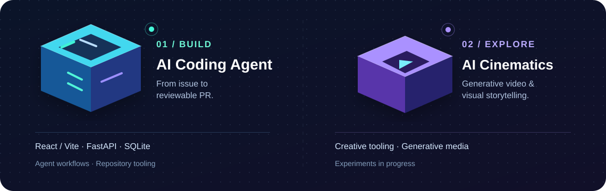
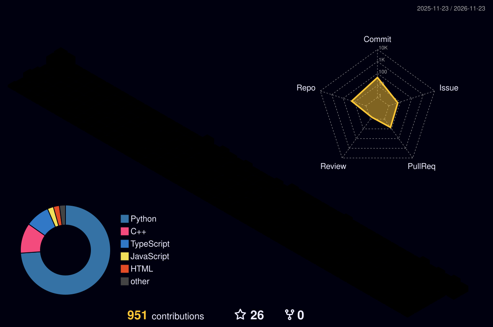

<!-- GitHub profile README | 3D edition | github.com/sh32ashutosh -->
<div align="center">



<br />

<a href="https://sh32ashutosh.netlify.app"></a>
<a href="https://linkedin.com/in/sh32ashutosh"></a>
<a href="mailto:sh32ashutosh@gmail.com"></a>
<a href="https://leetcode.com/u/pobedil/"></a>

<br /><br />


</div>

## `> whoami`

```yaml
name: Ashutosh Sharma
education: B.Tech Computer Science · Medi-Caps University (2024–2028)
location: Indore, India
focus:
  - Full-stack engineering
  - AI agents and LLM tooling
  - Developer experience and system design
currently_building: "An issue-to-PR AI coding agent"
```

I enjoy turning complex ideas into practical software—from polished React interfaces to backend systems and AI-assisted workflows. I'm currently exploring how autonomous coding agents can help developers understand issues, propose changes, and review the resulting code.

## `> featured_work`

<div align="center">



</div>

**01 / Issue-to-PR AI coding agent** — An in-progress project exploring repository issue understanding, AI-assisted code changes, and preparation of reviewable pull requests. Built with **React/Vite, FastAPI, and SQLite**.

**02 / AI cinematic experiments** — Exploring AI-generated video, visual storytelling, and creative production tooling.

<!-- Add real public repository/demo links here once they are available. Avoid linking to non-existent projects. -->

## `> toolchain`

<div align="center">

| Languages | Frontend | Backend & APIs |
|:---:|:---:|:---:|
|  |  |  |

| Data & storage | Tools & platforms |
|:---:|:---:|
|  |  |

</div>

<sub>Technologies used or explored; not an indication of equal expertise in all of them.</sub>

## `> milestones`

| Highlight | Details |
|:---|:---|
| ⭐ CodeChef | 3★ rating |
| 🥇 Google “The Big Code” 2026 | Top 1,500 globally |
| 🇮🇳 Smart India Hackathon 2025 | Finalist |
| 💻 Tata CodeVita Season 13 | Round 1 qualifier |

## `> git_contributions --render=3d`

<div align="center">

<!-- Generated by .github/workflows/profile-3d.yml. Run it once from GitHub Actions after upload. -->


<sub>3D contribution skyline — generated automatically from real GitHub activity.</sub>

<br /><br />


</div>

## `> beyond_github`

<div align="center">

<a href="https://leetcode.com/u/pobedil/"></a>

[Code360](https://www.naukri.com/code360/profile/Ashutoshsharma) · [Holopin](https://holopin.io/@sh32ashutosh) · [Portfolio](https://sh32ashutosh.netlify.app)

</div>

---

<div align="center">

### `> let's_build_something()`

Open to thoughtful collaborations on full-stack software, developer tools, and AI agent workflows.

**[Portfolio](https://sh32ashutosh.netlify.app)** · **[LinkedIn](https://linkedin.com/in/sh32ashutosh)** · **[Email](mailto:sh32ashutosh@gmail.com)**

<sub>Designed with code, curiosity &amp; a little isometric magic. © 2026</sub>

</div>
